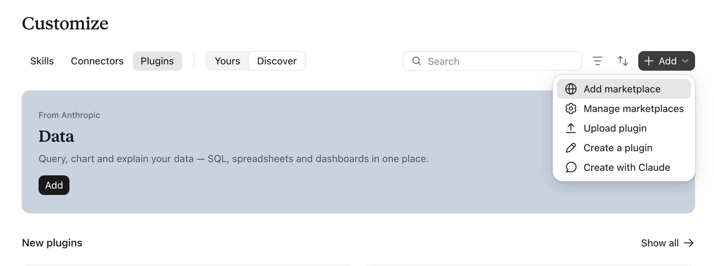
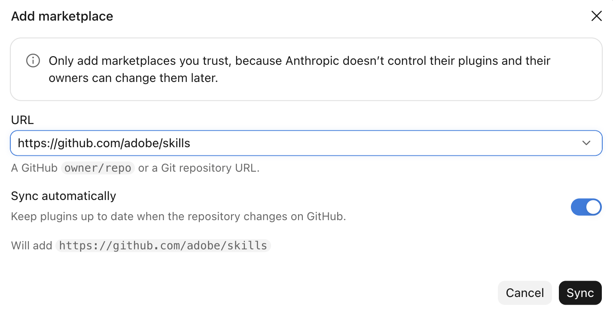
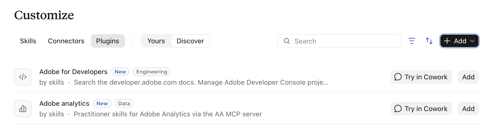

# Install in Claude

The Adobe for Developers plugin includes the connector and companion [skills](../skills.md) for common Adobe developer workflows. Follow the steps for Claude Desktop or Claude Code.

## Before you begin

* Have an Adobe account with access to the organization and services you want to use.
* Install Claude Desktop or Claude Code and sign in to your client.

<InlineAlert variant="warning" slots="text"/>

The connector uses a production endpoint, not a sandbox. Start with read-only requests and use a dedicated test project for changes. Installing the plugin does not grant additional Adobe access; your existing permissions still apply.

## Claude Desktop

1. Open Claude Desktop and select **Customize**.
1. Open **Plugins**, then select **+ Add > Add marketplace**.

   

1. Enter `https://github.com/adobe/skills` as the repository URL and press Enter. Select **Sync**.

   

1. Search for **Adobe for Developers**. Select **Add**, then **Continue** to complete the installation.

   

1. Complete Adobe sign-in when prompted.
1. Start a new chat and [verify the installation](#verify-the-installation).

If the plugin's skills are available but the connector does not activate, use the [manual MCP server setup](#manual-mcp-server-setup). This fallback is not a replacement for installing the plugin.

## Claude Code

Run these commands in a terminal:

```shell
claude plugin marketplace add adobe/skills
claude plugin install adobe-for-developers@adobe-skills
```

Check that the plugin is installed and enabled:

```shell
claude plugin list
```

Start a new Claude Code session and complete Adobe sign-in when prompted. The connector and companion skills are available in subsequent sessions.

If you are already in a Claude Code session, the equivalent installation commands are:

```text
/plugin marketplace add adobe/skills
/plugin install adobe-for-developers@adobe-skills
```

Start a new session after installing, then [verify the installation](#verify-the-installation).

## Verify the installation

1. Check that the plugin's skills are available:

   * **Claude Code:** Type `/` and look for skills with the `adobe-for-developers:` prefix.
   * **Claude Desktop:** Open the installed plugin and check its skills list.

1. Start a new chat and make a read-only request:

   > Use Adobe for Developers to list the Adobe organizations I can access, without creating or changing anything.

1. Choose an organization, then ask the plugin to list its projects.
1. Confirm that a connector tool runs and returns real data matching your expected access. An installed plugin alone does not prove that the connector is authenticated and working.

Before any write operation, verify the target organization and test project. Review proposed changes and approval prompts; client approval behavior varies.

## Manual MCP server setup

Use this fallback only for Claude Desktop when the plugin's skills are available but the hosted connector does not activate. Your organization's policies must allow manual MCP connections. If plugin installation itself fails, [contact support](../../support/index.md) instead of treating an MCP-only connection as a complete plugin installation.

Install a current [Node.js LTS release](https://nodejs.org/) and make sure `npx` is accessible to Claude Desktop.

<InlineAlert variant="warning" slots="text"/>

The plugin's own approval hooks may not apply to a manually configured server. Review client permissions and every proposed change.

1. Locate `claude_desktop_config.json`:

   * **macOS**: `~/Library/Application Support/Claude/claude_desktop_config.json`
   * **Windows**: `%APPDATA%\Claude\claude_desktop_config.json`

1. Create the file if it is absent. If it already exists, back it up and add the connection inside its existing `mcpServers` object. Preserve other servers and avoid adding a duplicate Adobe for Developers connection.

   For a new file, use this complete configuration:

   ```json
   {
     "mcpServers": {
       "adobe-for-developers": {
         "command": "npx",
         "args": [
           "mcp-remote@latest",
           "https://adp-connector.adobe.io/mcp"
         ]
       }
     }
   }
   ```

1. Save valid JSON without comments or trailing commas. On first use, `npx` may need network access to download `mcp-remote`.
1. Fully quit Claude Desktop, rather than only closing its window, and reopen it. On macOS, use **Command+Q**.
1. Complete Adobe sign-in in the browser when prompted, then repeat the [verification steps](#verify-the-installation).

[Back to Getting started](../index.md)
