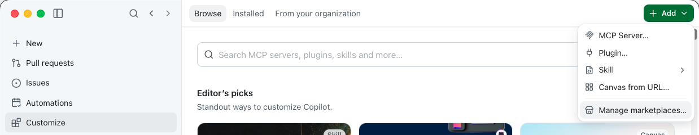
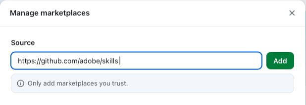
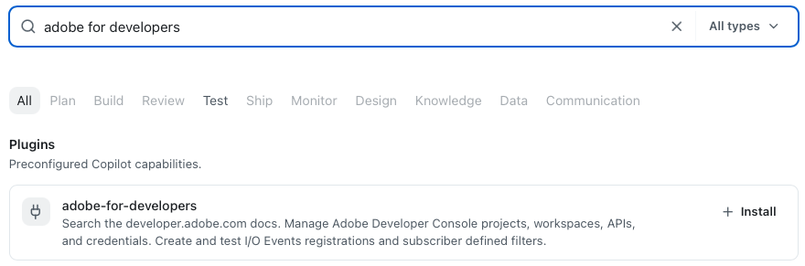

# Install in GitHub Copilot

The Adobe for Developers plugin includes the connector and companion [skills](../skills.md) for common Adobe developer workflows. Follow the steps for GitHub Copilot CLI or the GitHub Copilot desktop app.

## Before you begin

* Have an Adobe account with access to the organization and services you want to use.
* Install GitHub Copilot CLI or the GitHub Copilot app and sign in to your client.

<InlineAlert variant="warning" slots="text"/>

The connector uses a production endpoint, not a sandbox. Start with read-only requests and use a dedicated test project for changes. Installing the plugin does not grant additional Adobe access; your existing permissions still apply.

## GitHub Copilot CLI

Run these commands in a terminal:

```shell
copilot plugin marketplace add adobe/skills
copilot plugin install adobe-for-developers@adobe-skills
```

Check that the plugin is installed and enabled:

```shell
copilot plugin list
```

Start a new Copilot CLI session and complete Adobe sign-in when prompted. Run `/mcp` inside the session to check that the **Adobe for Developers** server is available.

If you are already in a Copilot CLI session, the equivalent installation commands are:

```text
/plugin marketplace add adobe/skills
/plugin install adobe-for-developers@adobe-skills
```

Start a new session after installing, then [verify the installation](#verify-the-installation).

## GitHub Copilot app

1. Open the GitHub Copilot app and select **Customize** in the sidebar.
1. Select **+ Add > Manage marketplaces**.

   

1. Enter `https://github.com/adobe/skills` as the source URL and select **Add**.

   

1. Wait for the marketplace to sync, then close the **Manage marketplaces** dialog.
1. Search for **Adobe for Developers** on the **Customize** page and select **Install**.

   

1. Open **Customize > Installed** and confirm that the plugin is enabled.
1. Complete Adobe sign-in when prompted, start a new session, and [verify the installation](#verify-the-installation).

## Verify the installation

1. Check that the plugin's skills are available:

   * **Copilot CLI:** Run `/skills` in the session.
   * **GitHub Copilot app:** Check the plugin under **Customize > Installed**.

1. Start a new chat and make a read-only request:

   > Use Adobe for Developers to list the Adobe organizations I can access, without creating or changing anything.

1. Choose an organization, then ask the plugin to list its projects.
1. Confirm that a connector tool runs and returns real data matching your expected access. An installed plugin alone does not prove that the connector is authenticated and working.

Before any write operation, verify the target organization and test project. Review proposed changes and approval prompts; client approval behavior varies.

[Back to Getting started](../index.md)
